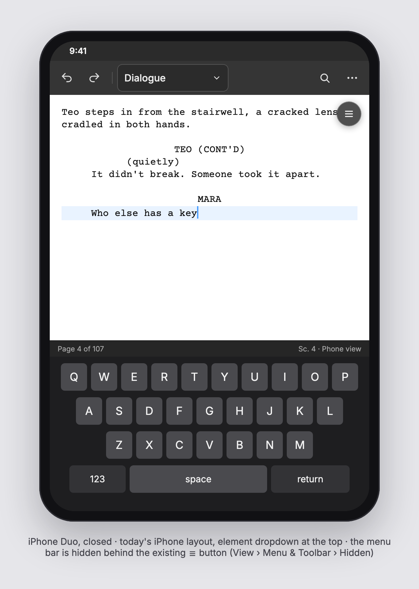
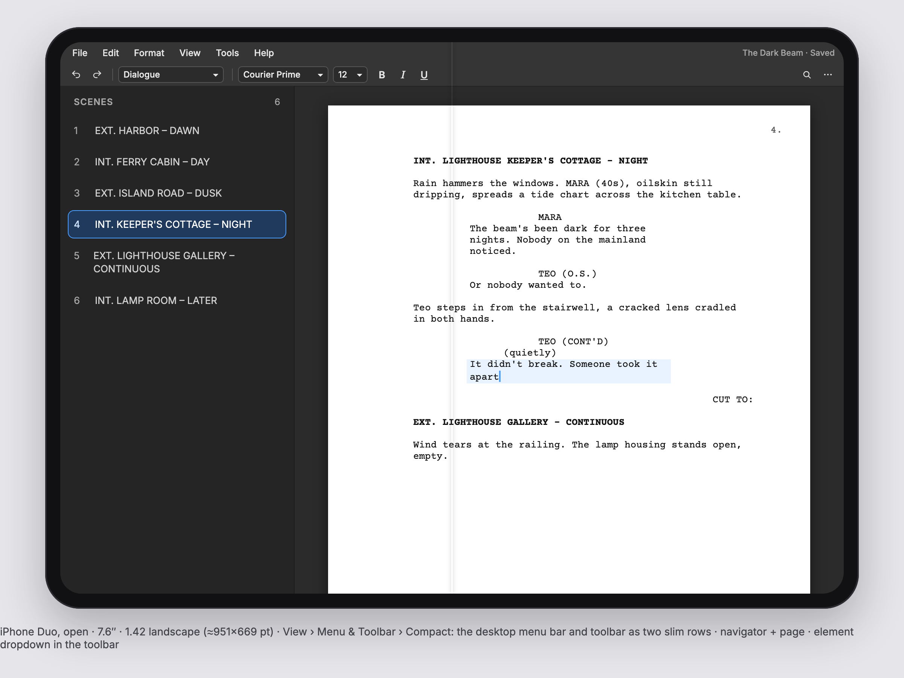
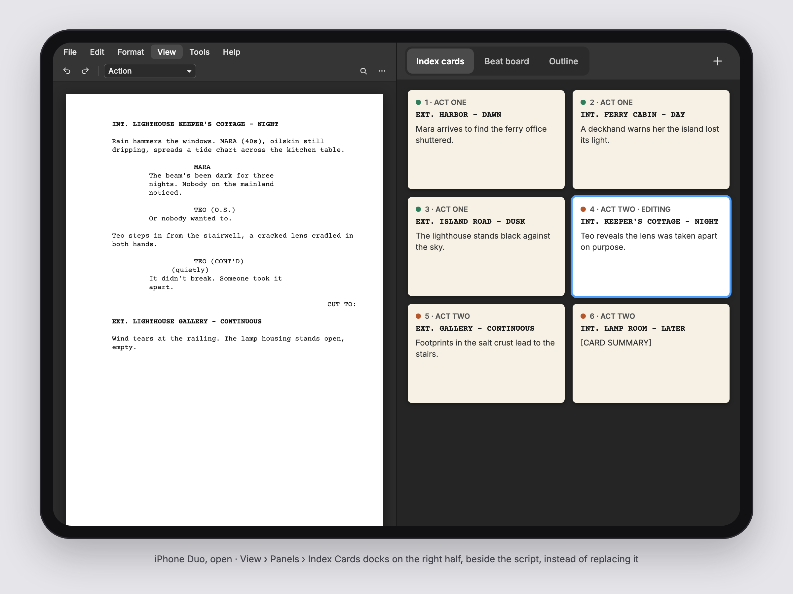
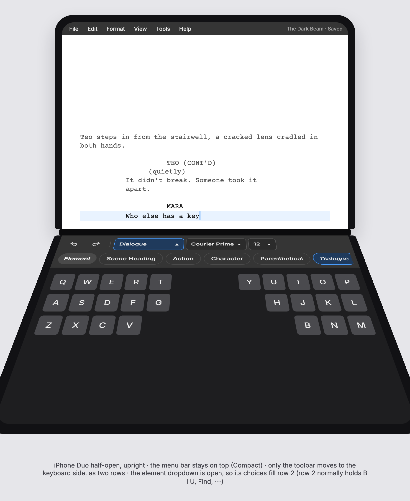
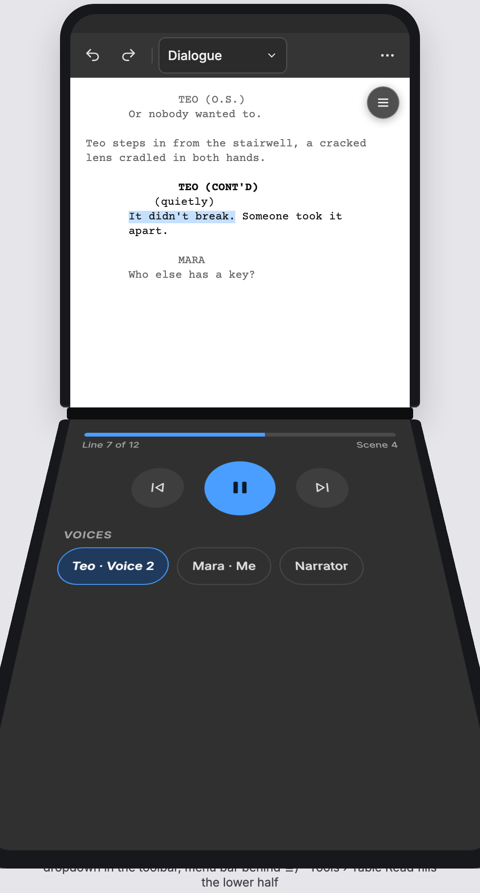
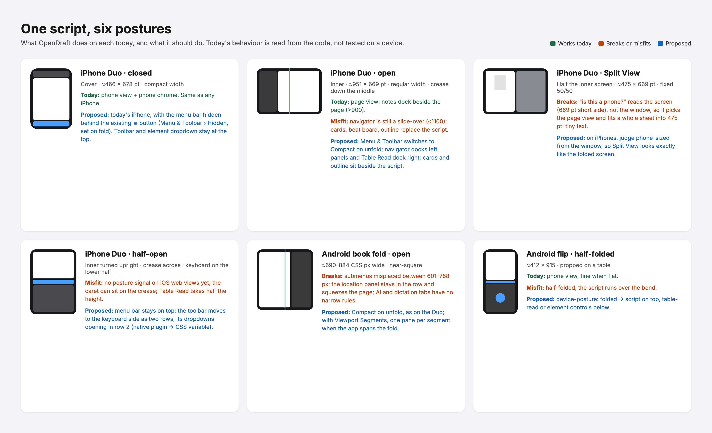
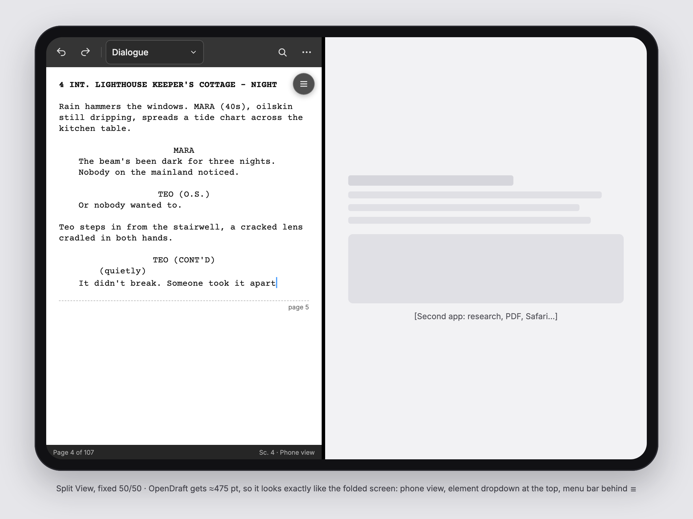
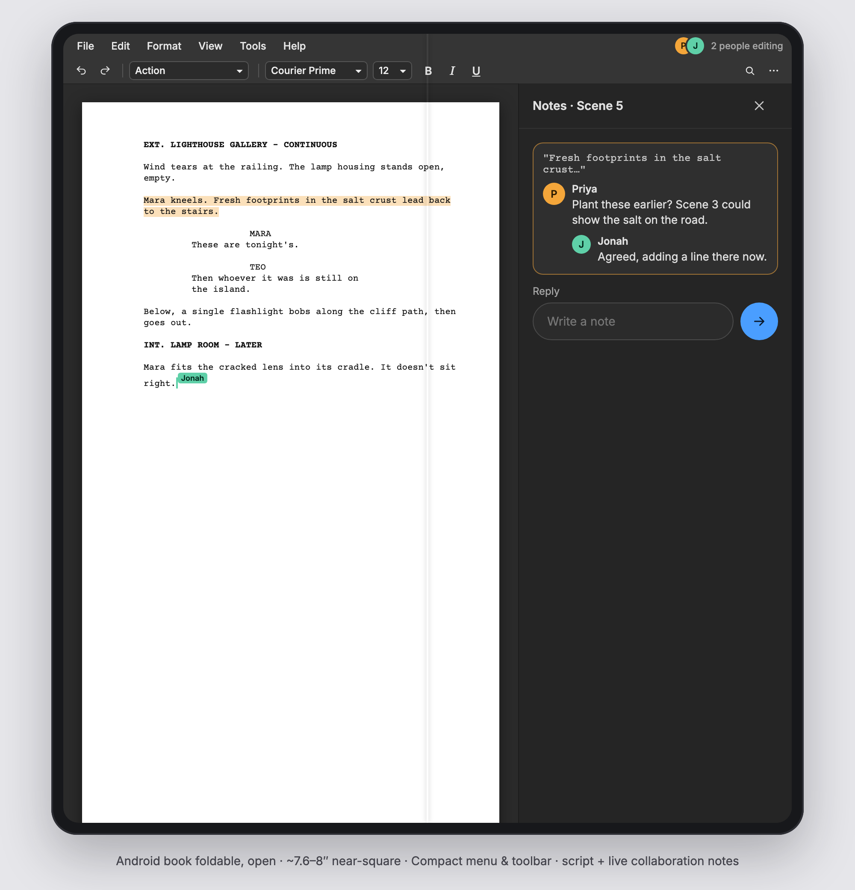

# Foldable support: design document and spec

Status: **design/acceptance checklist; browser implementation partly merged.** Written November 2026.
See [implementation and validation status](foldable-implementation-status.md) for
merged work and remaining native/dependency work.
Everything said here about current behaviour comes from reading the code;
none of it has been run on a foldable yet.

Covers the iPhone Duo (Apple's book-style foldable, September 2026),
Android book folds (Galaxy Z Fold, Pixel Fold) and Android flips. Mockups are
in [`docs/screenshots/foldables/`](screenshots/foldables/) and shown in
section 15.

## 1. Summary

OpenDraft already runs on phones and tablets. A foldable is both, and it can
change from one to the other while a script is open. This document specifies
how the existing interface should behave in each posture. It adds no new
menus, no new way to pick an element and nothing a desktop user would have to
learn:

- **Folded:** the app is today's iPhone app, with the menu bar hidden behind
  the existing ☰ button.
- **Open:** the existing Compact menu and toolbar, and the wide screen is
  used for what today covers or replaces the script, such as Table Read,
  Index Cards and compare.
- **Half-open at 90°:** in laptop posture the toolbar moves down to the
  keyboard side, in two rows. In book posture each half gets its own pane.

## 2. Goals and non-goals

**Goals**
1. Every feature reachable on every posture, from the same menu items as on
   desktop.
2. Fold and unfold mid-sentence without losing the caret, the selection, the
   scroll position or an open panel.
3. Use the open screen's width, which is the scarce resource after height.
4. Phones that do not fold behave exactly as they do today.

**Non-goals**
- A new menu, sheet, tab bar or element bar. These were considered and
  rejected (see section 14).
- Repurposing the volume buttons or Camera Control on iOS. App Review does
  not allow it (section 10).
- A two-page spread for writing. Each half is ≈475 pt wide, so a page there
  is 58% and 12 pt Courier comes out at about 9 px.

## 3. Design rules

1. **No new menu.** View › Menu & Toolbar already has Compact, Comfortable
   and Hidden. The app switches between them by itself:
   - **Folded:** Hidden. The menu bar goes behind the existing ☰ button;
     the toolbar stays.
   - **Open:** Compact.
2. **Phone-sized means today's phone.** The Duo cover screen, Duo Split View
   and Android cover screens get today's phone interface. The only change is
   that the menu bar is hidden while folded.
3. **Element selection does not move.** It stays the element dropdown in the
   toolbar, plus Tab and Enter, Format › Element and the shortcuts. At 90°
   the dropdown travels with the toolbar and works the same way.
4. **Same structure as desktop.** The menus keep their names, order and
   items. Panels open from View › Panels as they do now. Where the fold makes
   a list run sideways (section 6.3), its contents and order stay the same.
5. **The writer's choice wins.** Any mode or layout the writer picks is
   remembered for that posture and is never overridden by the automatic
   switch.
6. **Toolbar contents are the writer's.** Every toolbar arrangement here,
   including the two rows at 90°, lays out the writer's own toolbar items in
   their order, from the customisable toolbar (PR #217). The mockups show the
   Default preset.

## 4. Devices and platform signals

| Device / posture | Size (pt / CSS px) | Notes |
|---|---|---|
| iPhone Duo, closed (cover) | ≈466 × 678 | Compact width, like any iPhone |
| iPhone Duo, open | ≈951 × 669, 1.42 ratio | Regular × regular; crease runs vertically through the centre |
| iPhone Duo, Split View | ≈475 × 669 per app | Fixed 50/50, not resizable |
| iPhone Duo, half-open ~90° | two halves of the inner screen | Laptop (crease horizontal, keyboard on the lower half) or book (crease vertical) |
| Android book fold | open ≈690–884 near-square; cover ≈344–412 wide | |
| Android flip | ≈412 × 915 | Can be half-folded ("tabletop") |

Duo point sizes are third-party estimates; Apple has not published them.

**Physical controls on the Duo** (Apple's spec page):
- volume up and down;
- the side button, which holds Touch ID;
- Camera Control.

There is no Action button. Apple Pencil (USB-C) is supported, without
hover.

**Signals a web view can use:**

| Platform | Posture / fold | Notes |
|---|---|---|
| Android (Chromium WebView) | `@media (device-posture: folded)`; Viewport Segments (`env(viewport-segment-*)`, `visualViewport.segments`, `horizontal-/vertical-viewport-segments`) | Stable in Chrome 138. **Whether the WebView exposes them is unconfirmed — check first.** Jetpack WindowManager via a Tauri plugin is the fallback. |
| iOS (WKWebView) | None. Safari 27.1 has Viewport Segments and Device Posture only behind developer feature flags, and WKWebView can reach them only through a private preference. | Native, iOS 27.1: `UIHingeInteraction` reports the hinge (closed / partially open / fully open, or no hinge at all), and `reservedRegionsOfKind:divisionRegionKind options:includeInactive` the crease. `FoldPosture.m` passes both to the page. |
| Both | window size, `resize`, `orientationchange` | Always available. Enough for folded/open, not for 90°. |

## 5. What already exists and is reused

| Existing | Where | Used for |
|---|---|---|
| View › Menu & Toolbar: Compact (menu 28 + toolbar 30 pt), Comfortable (44 + 36; 46 + 52 on phones), Hidden (☰ button) | `MenuBar.tsx:3377`, `editorStore.ts:94` | Switched per posture |
| ☰ floating menu button and floating menu bar (Hidden mode) | `MenuBar.tsx:3734–3990` | The folded posture's menu |
| View › Layout: Page / Phone; `followDevice` | `editorStore.ts:1745–1770` | Remembered per posture |
| `html.phone` toggled live by `watchPhoneDevice` | `utils/phoneDevice.ts`, `main.tsx:93–99` | Already flips on fold/unfold |
| Toolbar with priority-based overflow ("⋯") | `Toolbar.tsx` | Unchanged except the 90° two-row layout |
| Customisable toolbar, presets, Views menu | **PR #217** (open) | Toolbar contents in every posture |
| Split screen: script plus Page View, Index Cards, Outline or Beat Board | **PR #214** (open) | Companion pane on the open screen and in book posture |
| Side-by-side compare | `ScriptDiffView.tsx` | One version per half |
| Table Read panel | `TableReadPanel.tsx`, `tableRead.css` | Placed per posture |
| Handwriting panel (Apple Pencil) | `ScribbleInput.tsx` | Placed per posture |

## 6. Spec, posture by posture

The overview is in the posture map image in section 15. Sizes are in CSS px,
which equal pt on iOS.

### 6.1 Folded: Duo cover, Duo Split View, Android cover



**Layout:** today's phone layout.
- Toolbar on top in the phone size: 52 px tall, 40 × 44 buttons, element
  dropdown 42 px tall and at least 128 px wide.
- Phone view.
- Status bar at the bottom.
- Panels and Table Read as they are on a phone now.

**Menu:** View › Menu & Toolbar › **Hidden** is selected automatically on
fold, with two differences from today's Hidden:
- The **toolbar stays.** Today `Toolbar.tsx:967` returns `null` in Hidden,
  which would take the element dropdown with it.
- The ☰ button's **default position** moves to just under the toolbar on the
  right: `top = toolbar bottom + 10`, `right = 12`. Today's default
  (`navPanelWidth + 14`, `10`) would sit on Undo. It stays draggable, and a
  dragged position is still remembered.

Tapping ☰ opens the existing floating menu bar. At ≤ 768 px its submenus
open inside the dropdown, as on phones now.

**Split View:** the iPhone check moves from the screen's short side to the
window's (section 7.3), so a 475-wide Split View pane is treated as a phone.
It then looks exactly like the cover screen.

**Acceptance:**
- [ ] On the cover screen, the toolbar and element dropdown are where they
      are on an iPhone today, and the menu bar is replaced by ☰.
- [ ] ☰ opens File · Edit · Format · View · Tools · Help with the same items
      as desktop, plus add-on items.
- [ ] View › Menu & Toolbar shows Hidden checked. Picking Comfortable
      restores today's phone menu bar and is remembered for the folded
      posture only.
- [ ] Ordinary (non-folding) phones: Hidden still hides both bars, as today.
- [ ] Duo Split View: phone view, phone chrome, no shrunken page.

### 6.2 Open flat: Duo inner screen, Android book fold



**Menu & Toolbar:** Compact is selected automatically on unfold: the
desktop menu bar and toolbar as two slim rows, 28 and 30 px. On a coarse
pointer, give menu items and toolbar buttons a transparent hit area of at
least 40 px; the bar looks the same.

**Script:**
- Page view, zoomed to fit the free width: 100% with Navigator closed
  (816 px page on a 951 px screen), ≈85% with Navigator docked at 240.
- Never below 70%. If panels would push it lower, Navigator becomes a
  slide-over again.

**Navigator:** docks left on a coarse pointer whenever the page still fits
at ≥ 80%. This replaces the `≤ 1100` slide-over rule for this case. The
left-edge swipe still works.

**Right column (300 px, full height):**
- Notes, Characters, Tags, Locations, Dialogue Tuner, Suggestions and
  add-on panels, which already dock above 900 px.
- **Table Read**, which today docks under the script at up to 48vh (≈320 of
  669 px).

The column shows the last one opened, with the other one tab away.

**Companion views:** Index Cards, Outline and Beat Board open as the
second pane of the split screen from PR #214 (Side by Side). On a foldable
the split defaults to the crease. Tapping a card or outline row scrolls the
script. On desktop and phones they keep today's behaviour.



**Also:**
- Compare versions opens side by side, one version per half.
- Story Timeline becomes a band across the bottom instead of a dialog.
- File › New Window opens a second script in Split View, on the inner
  display only.

**Acceptance:**
- [ ] Unfolding mid-typing keeps the caret, the selection and the scroll
      anchor, and switches to Compact unless the writer chose otherwise for
      the open posture.
- [ ] With Table Read open, the script keeps its full height.
- [ ] Index Cards beside the script: tapping a card moves the script.
- [ ] Folding back restores the folded posture's mode and layout.

### 6.3 Half-open 90°, laptop posture (crease horizontal)



**Top half:**
- The **menu bar stays on top** in the open posture's mode (Compact by
  default). Its menus drop down as usual, inside the top half.
- The script fills the rest.
- The caret line is kept above the crease: the editor's scroll margin
  equals the distance from the fold to the bottom of the top half.

**Keyboard side, just below the fold:** the **toolbar** moves here, in two
rows sized for fingers:

| | Spec |
|---|---|
| Container | Full width of the lower half; padding 8 px top, 6 px bottom, 10 px sides; 4 px between rows; toolbar background |
| Rows | 44 px tall, 4 px gap between controls |
| Content | The writer's toolbar items (#217) in their order, wrapped onto two rows. With the Default preset: row 1 Undo, Redo, element dropdown (150 px), font (130), size (60); row 2 B I U, Find, ⋯. |
| Dropdowns | **Open in row 2.** Tapping a dropdown in the toolbar (element, font, size, the Views menu and others) replaces row 2 with that dropdown's choices in one horizontally scrolling line. |
| Choice line | Leading crumb button with the dropdown's name, which closes it; chips 36 px tall, radius 18, padding 0 14; the current choice uses the accent border and fill; a trailing ✕. Picking a choice applies it and restores row 2. |
| Overflow | Items that do not fit both rows go into ⋯, whose list opens in row 2 as well. |

Nothing drops over the script or the keyboard. Choices and their order are
exactly those of the normal dropdown; only the direction the list runs
differs.

**Below the two rows:**
- While typing: the system keyboard.
- With the keyboard down (hardware keyboard, Pencil, or reading): whichever
  panel is open fills this space:
  - Table Read: large transport and the current line.
  - Handwriting: a full-width writing pad, the best Pencil posture there is.
  - Index Cards or Outline: a grid.
  - Notes, Characters and the other panels.

**Device check needed:** how much of the lower half the iOS keyboard
takes. If it covers all of it, the two rows sit just above the fold on the
top half, still next to the keyboard.

**Acceptance:**
- [ ] The menu bar is at the top of the top half; only the toolbar moves.
- [ ] The toolbar shows the writer's current toolbar layout in two rows.
- [ ] The element dropdown's choices open in row 2, the current one is
      highlighted, picking one changes the element, and the toolbar comes
      back.
- [ ] VoiceOver/TalkBack and keyboard: the choice line is a `listbox` of
      `option`s; arrow keys move, Enter picks, Esc closes and returns focus
      to the dropdown.
- [ ] The caret never sits under the crease.

### 6.4 Half-open 90°, book posture (crease vertical)

- **Left half:** the script in the phone view, under Compact menu and
  toolbar.
- **Right half:** the open companion: a split-screen pane (#214), a panel,
  compare, or Table Read.
- **Table Read on a desk for a group:** the right half shows the line being
  read in large type, with the speaker's name in their character colour.
  Transport stays at the bottom.
- With nothing open, the script carries on in the right half like a book,
  one column per half.

### 6.5 Android flip, tabletop

Phone layout on the top half, with the toolbar on top and the menu behind
☰. The lower half behaves like the laptop posture's lower half: Table Read,
a panel, or the keyboard.



## 7. State model

### 7.1 Postures

```ts
type SizeClass = 'phone' | 'wide';           // from the window, section 7.3
type Fold = 'flat' | 'laptop' | 'book';      // from the posture signal
type PostureKey = 'folded' | 'open';         // what choices are remembered against
// folded = size 'phone' on a foldable; open = size 'wide' (any fold)
```

### 7.2 What is remembered

Saved in the existing view state (`saveViewState`), per posture key:

```ts
byPosture: {
  folded?: { toolbarMode?: 'compact'|'comfortable'|'hidden'; viewLayout?: 'page'|'phone' };
  open?:   { toolbarMode?: ...; viewLayout?: ... };
}
```

- **Defaults:** folded → `hidden` + `phone`; open → `compact` + `page`.
- **On posture change:** apply the stored value, else the default.
- **On a pick from the View menu:** store it under the current key only.
- **Migration:**
  - Ordinary phones keep using today's single `toolbarMode` / `viewLayout`.
  - A foldable's first launch seeds both `folded` and `open` from any
    explicitly saved toolbar/layout values. Posture defaults apply only to
    settings the writer never chose.
- **Debounce posture changes by 150 ms** so the hinge passing through
  angles does not flicker the layout.

### 7.3 Phone-sized rule

`isPhoneDevice()` (`utils/phoneDevice.ts`) checks for a coarse pointer and a
screen whose short side is under 600. On an **iPhone** user agent it changes
to the **window's** short side under 600. iPads keep the screen rule, so
Slide Over is not affected. An ordinary iPhone in landscape is ≈430 tall,
so it is a phone either way.

## 8. Posture detection spec

New module `frontend/src/utils/foldPosture.ts`:

```ts
export interface FoldState {
  size: 'phone' | 'wide';
  fold: 'flat' | 'laptop' | 'book';
  foldRect: DOMRect | null;   // the hinge/crease in viewport coordinates
}
export function getFoldState(): FoldState;
export const FOLD_CHANGE_EVENT = 'opendraft:foldchange';
```

**Sources, in order:**
1. **iOS:** `FoldPosture.m`, attached to the web view by the
   `fold_watch_start` command, observes `UIHingeInteraction` and the
   `division` reserved region (UIKit's name for it; there is no `.fold`) and
   pushes `{ hinge, angle, division, viewport }` to the page as
   `window.__opendraftNativeFold` plus an `opendraft:nativefold` event. Browser
   segments still win if WebKit ever ships them.
2. **Android:** `visualViewport.segments` plus `device-posture`. If the
   WebView lacks them, a Tauri plugin built on Jetpack WindowManager
   `FoldingFeature`.
3. **Fallback:** size only, with fold `'flat'`.

**Classes and variables on `<html>`:**
- `html.wide`, `html.fold-laptop`, `html.fold-book`;
- `--fold-top`, `--fold-left`, `--fold-width`, `--fold-height` in px.

CSS places the 90° slots with these.

## 9. Feature placement

| Feature | Folded | Open flat | Laptop 90° | Book 90° |
|---|---|---|---|---|
| Menu bar | behind ☰ | top, Compact | top, Compact | top of the script half |
| Toolbar | top, phone size | top, Compact | keyboard side, two rows; dropdowns open in row 2 | top of the script half |
| Element selection | toolbar dropdown | same | same dropdown, opens in row 2 | same |
| Script | phone view | page, fit width | top half | left half, phone view |
| Navigator | slide-over | docked left | slide-over | slide-over |
| Notes, Characters, Tags, Locations, Tuner, Suggestions, add-ons | full-screen overlay | right column | lower half | right half |
| Table Read | dock under script | right column, full height | lower half | right half, large line |
| Index Cards / Outline / Beat Board | replace script | split pane beside script (#214) | lower half | right half |
| Compare versions | full screen | side by side, a version per half | — | a version per half |
| Story Timeline | dialog | bottom band | lower half | — |
| Handwriting (Pencil) | hidden on Duo today (11.2) | right pane | lower half as a pad | right half |

## 10. Side buttons and media controls

**What iOS allows:**
- Third-party apps only get volume and Camera Control presses through
  `AVCaptureEventInteraction`, while a camera capture session is running.
  Repurposing them otherwise has been rejected under App Review guideline
  2.5.9.
- The side button and Touch ID are reserved for the system.
- The Duo has no Action button.

**What to build:**
1. **Table Read media controls (iOS):**
   - Register `MPRemoteCommandCenter` play/pause, next track and previous
     track, mapped to the panel's own line-step buttons.
   - Set Now Playing info: title = scene heading, artist = speaking
     character.
   - Add the `audio` background mode to the Info.plist patch, in
     `build-ios-device.sh` and CI, so reading continues when locked or
     folded.
   - Controls then work from the lock screen, Control Center, AirPods and
     an Apple Watch.
   - The volume buttons already set the volume.
2. **Android:**
   - A `MediaSession` for the same controls.
   - Optionally, a setting "Volume keys step through Table Read lines",
     **off by default**. Android allows this for a foreground app, but it
     needs a plugin, because the WebView does not receive those keys.
3. **Camera Control:** nothing until OpenDraft has a camera feature.

## 11. Problems in the current code

1. **Split View is not seen as phone-sized** (`utils/phoneDevice.ts`):
   section 7.3.
2. **Handwriting is hidden on the Duo:** `supportsApplePencil()`
   (`services/platform.ts:127`) returns false for every iPhone user agent.
   Ask the native side instead.
3. **New Window on the cover screen:** `supports_multiple_windows` reports
   `supportsMultipleScenes`, which is likely true on the Duo. iOS will not
   create a window on the outer display, so hide or refuse it there.
4. **Hidden mode removes the toolbar:** `Toolbar.tsx:967` (section 6.1).
5. **Submenu breakpoint mismatch at 601–768 px:** `positionSubmenu`
   (`MenuBar.tsx:2717`) uses 600, but the CSS
   (`screenplay.css:11171/11272`) uses 768. This hits Android book folds in
   portrait and iPad mini today.
6. **Location database has no narrow-width overlay rule**
   (`screenplay.css:1253`).
7. **The left-edge swipe reads `innerWidth <= 1100` at render**
   (`ScreenplayEditor.tsx:1063`), so it can be stale after fold/unfold.
8. **`trackIpadWindowMode` would mark Duo Split View `ios-windowed`** and
   indent the menu bar for controls that may not be there. Check on a
   device.
9. **No background audio on iOS:** Table Read stops when the screen locks.

Items 5–7 are bugs on existing devices and can be fixed now.

## 12. Accessibility, languages, themes

- **Hit targets:** every control at least 44 px in phone and 90° layouts,
  and at least 40 px hit area in Compact on touch.
- **Names:** the 90° rows and the choice line use the same accessible
  names as the toolbar controls they come from. Moving focus between rows
  follows the reading order.
- **Languages:** no new strings except the ☰ button's existing label. Rows
  must cope with longer translations (German, Russian), which they do by
  overflowing into ⋯ and by the choice line scrolling.
- **Themes:** use the existing CSS variables (`--fd-toolbar-bg`,
  `--fd-accent`, …) so light, dark and Dark Pages all work.
- **Reduced motion:** posture changes swap layouts without animating.

## 13. Work packages: how to help

Each package is a pull request against `main`. Comment on the tracking issue
to claim one. The packages marked "now" fix things on devices people already
have and need no foldable.

| # | Package | Depends on | Size | Skills | Test without a foldable? |
|---|---|---|---|---|---|
| WP1 | Submenu breakpoint fix (11.5) and Location database overlay (11.6) | — | S | CSS/TS | Yes, **now** |
| WP2 | Swipe threshold re-read on resize (11.7) | — | S | React | Yes, **now** |
| WP3 | `foldPosture.ts`: Android Viewport Segments / Device Posture + fallback | — | M | TS, Android WebView | Chrome DevTools foldable emulation |
| WP4 | iOS Tauri fold plugin (`reservedRegions` → event + CSS variables) | WP3 interface | M | Swift, Tauri plugins | Xcode simulator (Duo) |
| WP5 | Phone-sized rule from the window on iPhone (7.3) | — | S | TS | iPhone simulator + resizable window |
| WP6 | Per-posture memory for Menu & Toolbar mode and layout (7.2) | WP3 or WP5 | M | Zustand store | Unit tests |
| WP7 | Hidden keeps the toolbar on a folded foldable; ☰ default position (6.1) | WP6 | S | React/CSS | Partly |
| WP8 | Open layout: fit-width zoom, Navigator docking, right column for panels and Table Read (6.2) | WP3 | L | React/CSS | Wide touch window |
| WP9 | Companion panes on the split screen from #214, defaulting to the crease | #214 merged, WP3 | M | React | Wide window |
| WP10 | Laptop posture: toolbar in two rows at the fold, dropdowns opening in row 2 (6.3) | #217 merged, WP3/WP4 | L | React, a11y | DevTools posture emulation |
| WP11 | Book posture and flip tabletop slots (6.4, 6.5) | WP3/WP4 | M | React/CSS | DevTools emulation |
| WP12 | Table Read media controls + background audio (10) | — | M | Swift / Kotlin, Tauri | Any phone, **now** |
| WP13 | Duo fixes: Pencil detection, New Window on the cover (11.2, 11.3) | WP4 | S | Swift/TS | Duo simulator |

Ground rules for contributors: the core repo stays plugin-agnostic, all
user-facing strings go through i18n, and nothing in this document adds a
new menu. See [`CONTRIBUTING.md`](CONTRIBUTING.md).

## 14. Alternatives considered and rejected

- **A new tabbed Menu sheet for small screens.** Rejected: a new structure
  to learn. The existing ☰ floating menu already works.
- **An element bar along the bottom, by the keyboard.** Rejected: element
  selection must stay the toolbar dropdown everyone knows. A bottom bar also
  duplicated the control.
- **Merging menu bar and toolbar into one row on the open screen.**
  Rejected in favour of the existing Compact mode.
- **Moving the menu bar to the keyboard side at 90°.** Rejected: only the
  toolbar moves; the menus stay where desktop has them.
- **Volume buttons to step through lines on iOS.** Not allowed (section 10).

## 15. Mockups

| | |
|---|---|
|  | All six postures: today's behaviour and the proposal |
|  | Duo closed: today's iPhone layout, menu bar behind ☰ |
|  | Duo Split View: same as folded |
|  | Duo open: Compact menu and toolbar, Navigator docked, page fitted |
|  | Duo open: Index Cards beside the script |
|  | Duo at 90°, laptop: toolbar at the keyboard in two rows, element choices open in row 2 |
|  | Android book fold, open |
|  | Android flip, tabletop: Table Read below the hinge |

The interactive prototype was recorded in
[`prototype.gif`](screenshots/foldables/prototype.gif). It shows the folded ☰
menu, unfolding to Compact, the 90° toolbar with element choices in row 2,
and Table Read moving between postures.

## 16. Testing

- **iPhone Duo:** the Xcode simulator. Cover; open; Split View on both
  sides; half-open in both orientations; fold and unfold mid-typing.
- **Android:** the foldable profiles in the Android Studio emulator (Pixel
  Fold, 7.6" Fold-in, flip). Chrome DevTools' posture and segment emulation
  for the web build.
- **Regression:**
  - ordinary iPhones and Android phones unchanged, including Hidden
    mode;
  - iPad Slide Over still gets the page view;
  - desktop unaffected.
- **Automated:**
  - unit tests for the posture state machine and per-posture memory (WP6);
  - a test that the 90° choice line lists exactly the dropdown's options in
    order (WP10).

## 17. Open questions

1. How much of the lower half does the iOS keyboard take in laptop posture?
   This decides whether the toolbar rows sit below or above the fold.
2. Does Android System WebView expose Viewport Segments and Device Posture?
   If not, WP3 needs the WindowManager plugin.
3. Should Hidden keep the toolbar on ordinary phones too, for consistency?
   The proposal says no, so phones stay exactly as they are.
4. Does the Duo show iPadOS-style window controls in Split View (11.8)?

## Sources

- iPhone Duo specs: https://www.apple.com/in/iphone-duo/specs/
- Size classes, reserved regions, multitasking: https://blakecrosley.com/blog/iphone-duo-for-developers
- iOS 27 on Duo (Split View, keyboard, postures): https://macrumors.com/2026/09/10/apple-details-how-ios-27-adapts-to-iphone-duo
- Split View is a fixed 50/50: https://macrumors.com/2026/09/11/iphone-duo-split-view-not-like-ipad
- Capture controls, WWDC25: https://developer.apple.com/videos/play/wwdc2025/253/
- `AVCaptureEventInteraction`: https://developer.apple.com/documentation/avkit/avcaptureeventinteraction
- Volume buttons and guideline 2.5.9: https://developer.apple.com/forums/thread/696271
- Viewport Segments intent to ship: https://groups.google.com/a/chromium.org/g/blink-dev/c/pxWV6Es3T0Q
- Foldable APIs overview: https://developer.chrome.com/blog/foldable-apis-ot
