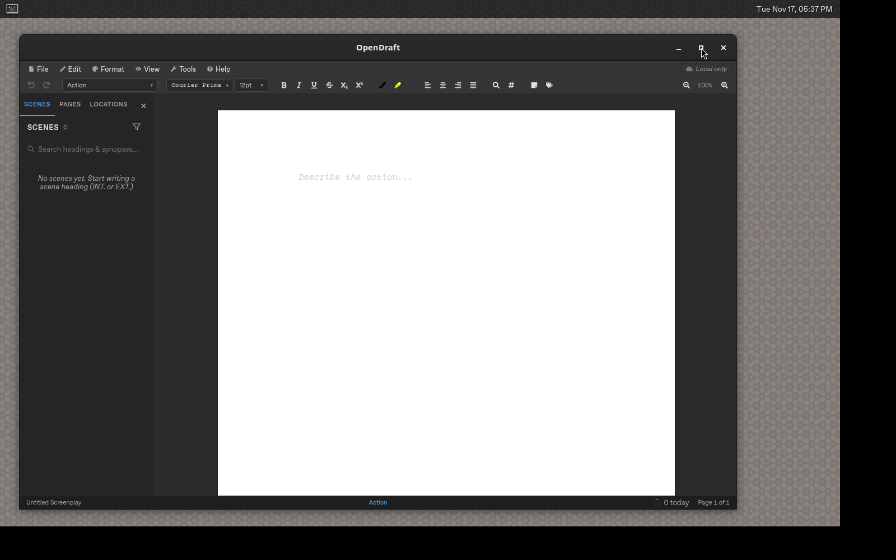

# Linux title-bar buttons (#271)

Tao 0.35.3 creates its Wayland title bar as an `EventBox` containing a
`HeaderBar`, with `above-child` enabled. The wrapper's input window intercepts
clicks before the minimize, maximize and close buttons receive them. A title-bar
double-click can still maximize the window, matching the issue's workaround.

OpenDraft now puts that wrapper's input window below its children. The guard
requires both the event box and its header-bar child; a direct header, another
custom title bar, or X11 server-side decorations are left alone. Setup applies the fix immediately to the initial native windows, before the
splash transition, and to each window built by New Window. It does not depend
on any page loading or committing. Only the asynchronous New Window command
dispatches its GTK access to the main thread; startup already runs there.
Linux file-association launches use the initial window via CLI arguments. The
separate warm `RunEvent::Opened` path is currently macOS/iOS-only. No window sizing, startup delays, decorations,
GPU settings or platform selection are changed.

## Verification

The reported behavior was reproduced with the released v2.13.0 Debian binary,
GTK 3 and a nested Weston 14 Wayland desktop on Xvfb, using real XTest pointer
clicks passed through Weston's X11 backend. The storage profile was disposable
and the document blank. Initial clicks on all three title-bar buttons did
nothing; a double-click in the title bar maximized the window.

A diagnostic preload shim then changed only the same `above-child` property
on Tao's event-box/header-bar pair. The first maximize click worked, as did
restore and minimize. In a separate fresh launch, the first close click exited
the app. This isolates the native GTK operation; it is **not** a locally rebuilt
candidate binary. The shim is a testing tool, not shipped app code.

| Released app: maximize click ignored | Same app with GTK routing correction |
| --- | --- |
|  |  |

The native regression tests create **real Tao windows** using Tauri's pinned
Tao, before creating any webview. The Wayland case checks both initial and later
windows, asserts the actual EventBox/HeaderBar structure, and checks input
ordering after applying the fix. A changed upstream structure fails explicitly
instead of allowing the shape guard to silently skip. A separate X11 process
checks that its native decorations remain unchanged.

Both display tests are `#[ignore]`, so ordinary headless `cargo test --lib`
runs skip them. The main `test.yml` workflow opts in on pull requests and pushes
to main. Its combined Linux/Android job uses Ubuntu 22.04, matching the Linux
release build, and reuses one frontend build for both native targets. It starts
a headless Weston Wayland compositor, then runs X11 separately under Xvfb:

```sh
cd src-tauri
../test-script/check-linux-titlebar.sh
```

The script needs Weston 9 (Ubuntu 22.04), Xvfb, a session bus, and the normal
Tauri Linux build dependencies. A display/compositor setup failure fails CI;
it is not silently skipped in this explicit run. No GPU or physical device is
needed.

KDE/KWin, the reporter's theme and hardware, scaling combinations, and every
Wayland compositor have not been tested. A reporter retest remains useful.
When changing the pinned Tao version, revisit this workaround against its
`src/platform_impl/linux/wayland/header.rs` implementation.
