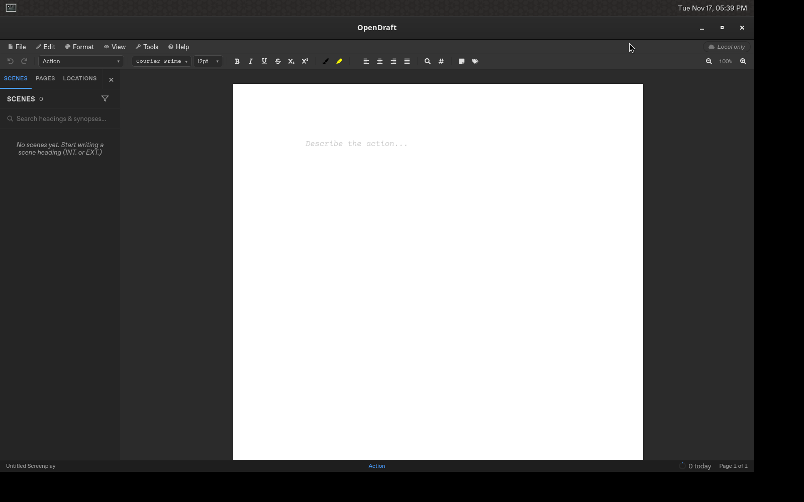

# Linux title-bar buttons (#271)

Tao 0.35.3 creates its Wayland title bar as an `EventBox` containing a
`HeaderBar`, with `above-child` enabled. The wrapper's input window intercepts
clicks before the minimize, maximize and close buttons receive them. A title-bar
double-click can still maximize the window, matching the issue's workaround.

OpenDraft now puts that wrapper's input window below its children. The guard
requires both the event box and its header-bar child; a direct header, another
custom title bar, or X11 server-side decorations are left alone. The page-start
hook covers both the initial window and windows created later. GTK access is
dispatched to the main thread. No window sizing, startup delays, decorations,
GPU settings or platform selection are changed.

## Verification

The reported behavior was reproduced with the released v2.13.0 Debian binary,
GTK 3 and a nested Weston 14 Wayland desktop on Xvfb, using real XTest pointer
clicks passed through Weston's X11 backend. The storage profile was disposable
and the document blank. Initial clicks on all three title-bar buttons did
nothing; a double-click in the title bar maximized the window.

A diagnostic preload shim then changed only the same `above-child` property
on Tao's event-box/header-bar pair. The first maximize click worked, as did
restore and minimize. In a separate fresh launch, the first close click exited
the app. This isolates the native GTK operation; it is **not** a locally rebuilt
candidate binary. The shim is a testing tool, not shipped app code.

| Released app: maximize click ignored | Same app with GTK routing correction |
| --- | --- |
|  |  |

The native GTK regression test covers the Tao wrapper, repeated application,
server-side decorations, a direct GTK header and unrelated custom decorations.
The Linux title-bar workflow compiles the actual Linux application library and
runs that test on a virtual display:

```sh
cd src-tauri
xvfb-run -a cargo test --locked --lib linux_titlebar::tests -- --test-threads=1
```

KDE/KWin, the reporter's theme and hardware, scaling combinations, and every
Wayland compositor have not been tested. A reporter retest remains useful.
When changing the pinned Tao version, revisit this workaround against its
`src/platform_impl/linux/wayland/header.rs` implementation.
