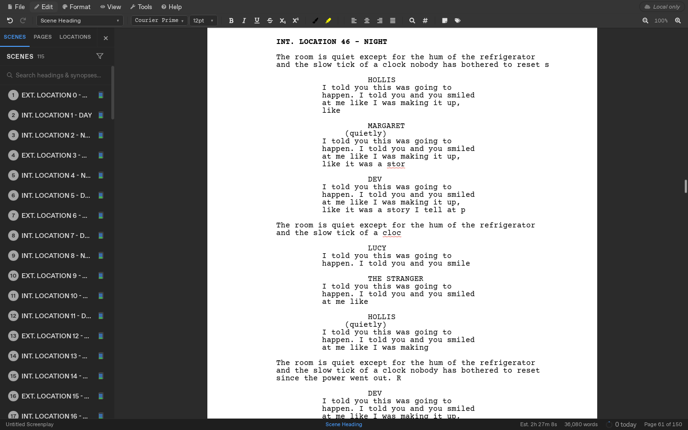

# Issue #229: native Linux scrolling investigation

Measured on 15 November 2026 in the **released Tauri/WebKitGTK app**. This
investigates the reporter's remaining scrolling complaint on v2.13.0; typing
and held Backspace were reported responsive. It does not close #229 or establish
behavior on the reporter's CachyOS/Intel/display stack.

## Build and environment

- Official `OpenDraft_2.13.0_amd64.deb`, release tag
  `41fd8b90c22309729f807f388d36b16d700eea38`. Native IPC reports **2.13.0**.
- DEB SHA-256:
  `7a3e286e43e0e9e8e224d17d93376237a35cc53062bad249d9d3945e3901907e`.
- Executable SHA-256:
  `76fa818c208382bd679f033b0bb53cb8e17059c42759e372b435afb490d9066b`.
- Debian 13, kernel 6.18.57, AMD EPYC 9V74, CPU quota **2 cores**, 8 GiB memory
  limit. WebKitGTK/JavaScriptCore **2.52.6-1~deb13u1**, GTK3, X11 under Xvfb.
  Window 1440×900, device scale 1, Courier Prime, 12 pt, Page layout, 100% zoom.
- **No `/dev/dri` or `/sys/class/drm`**. The app logs no DRM drivers and chooses
  `WEBKIT_DISABLE_DMABUF_RENDERER=1`. The comparison with
  `WEBKIT_DISABLE_COMPOSITING_MODE=1` also uses a software path; it does not
  test accelerated Intel/AMD DMA-BUF or Wayland.
- Dependencies were extracted to user storage. A read-only bubblewrap merged
  library namespace supplied Debian's absolute WebKit helper paths; no system
  package/library files were modified. App data/config/cache/runtime were fresh
  disposable XDG directories, verified through native IPC before fixture load.

## Method

The [native harness](../../test-script/native-scroll/README.md) drives the native
window with **120 trusted XTest wheel notches at requested 33 ms intervals**, then
observes 600 ms of tail work. Every phase verifies input delivery, scroll direction
and distance, unchanged ProseMirror document and selection, visibility and focus.
The fixed fixture has 3,110 blocks, 36,080 words, **150 rendered screenplay pages**
and 115 scenes. It uses `screenplay(184)` minus its final 14 blocks, not the
generator's approximate size as a page count. The fixture hash is in each report.

Navigator uses the **Scenes tab**. Settings go through real menu handlers; the
harness requires 115 Navigator scenes when open and spellcheck decorations when
enabled (304 marks in these runs). Loading the fixture emits a normal Tiptap
content update. Pilot runs that failed to populate Navigator are excluded from
the evidence and conclusions below. The page counter counts gaps, excluding
header/footer bands; see the correction in [the earlier typing report](issue-229-typing.md).

Each settings/rendering matrix has three rounds, reversing settings order on
alternate rounds, and down/up phases for all four Navigator/spellcheck combinations.
Timing phases have CPU sampling/Timeline off. Separate profiled phases capture
WebKit Timeline paint/layout/style records and JavaScript samples. rAF intervals
measure callback pacing, **not frame presentation or input-to-photon latency**.
Process CPU deltas include UI, WebKit children and Xvfb separately. No builds or
other substantial test workloads ran alongside these measurements.

## Results

Each row uses six unprofiled phases (three down/up pairs). CPU is the median
WebKit WebProcess CPU per ~4.61-second phase; frame values are the range of
**per-phase p95** rAF intervals, not pooled percentiles.

| Navigator | Spellcheck | Default CPU ms | Default p95 ms | Compositing off CPU ms | Compositing off p95 ms |
| --- | --- | ---: | ---: | ---: | ---: |
| Off | Off | 3,945 | 24–40 | 4,020 | 26–37 |
| On | Off | 4,115 | 29–39 | 4,125 | 26–39 |
| Off | On | 3,985 | 23–37 | 3,945 | 23–37 |
| On | On | 4,175 | 28–39 | 4,140 | 25–41 |

These small, overlapping setting differences do not identify Navigator or
spellcheck as the scrolling cause in this workload. The rendering comparison
does not show a reliable reason to change the app’s GPU/compositing policy:
both modes are software here, measured sequentially rather than as randomized
independent trials. The first fresh-app phase also has a warmup cost.

The **separate paired decoration experiment** keeps both features enabled,
runs three rounds with alternating arm order, and isolates only page CSS:

| Decoration | WebProcess CPU ms (median) | Per-phase p95 rAF ms range |
| --- | ---: | ---: |
| default | 4,175 | 25–40 |
| outline | 3,400 | 18–31 |
| off | 3,395 | 22–30 |

Replacing the shadow with an outline reduces median WebProcess CPU from
**4,175 to 3,400 ms (18.6%)** in these six phases per arm. The no-decoration
arm is similar (3,395 ms). This isolates an avoidable paint cost. Frame timing
still has outliers and these are small VM samples, not a universal FPS or
latency guarantee.

Separately profiled down/up traces support the paint hypothesis:

| Decoration/direction | Paint inclusive ms | Layout inclusive ms |
| --- | ---: | ---: |
| default/down | 3,172.98 | 13.41 |
| default/up | 3,204.71 | 12.12 |
| outline/down | 2,594.26 | 12.21 |
| outline/up | 2,505.39 | 11.37 |

## Measured change

The native trace motivated a paired page-decoration experiment: stock blurred
shadow, no shadow, and a thin outline. The outline preserves the page boundary
and does not affect box dimensions or pagination. The experiment changes only
CSS in the disposable released app window; it is not a rebuilt native binary.
The production change applies that same outline in the frontend stylesheet,
with the existing light-theme edge color and no edge in Phone/print layouts.
It is scoped to the **Linux desktop app only**: `main.tsx` sets
`linux-desktop` on the root element when the desktop Tauri app runs on Linux,
and the outline rules require that class. macOS, Windows, the mobile apps and
every browser (Linux browsers included) keep the original blurred shadow, so
their appearance is unchanged.
The production frontend build (`npm run build`) passed. A Chromium check of
that production build, with the outline applied to every platform at the time,
verified 150 pages, the light/dark page edges, unchanged
816×164,360 px page dimensions between themes, no edge in Phone/print layouts,
and no page errors. Results are in
[frontend-checks.json](issue-229-native-scroll-2026-11-15/frontend-checks.json).
The updated long-script browser regression also requires populated Navigator
scenes rather than merely an open, empty panel. All four setting combinations
passed in both Chromium and Playwright WebKit (eight cases); these remain
browser behavior checks, separate from the native measurements. Playwright
WebKit ran in the read-only dependency namespace with its host dependency
precheck bypassed. All 11 inspector/sampler/summary checks and the launcher’s
shell syntax check passed.

## Evidence and reproduction

Raw per-phase timing/CPU/invariant reports and trace aggregates with SHA-256s
are in [the evidence directory](issue-229-native-scroll-2026-11-15/). There are
**66 unprofiled phases and 10 separate profiled phases**, all with unchanged
script/selection and 120 trusted wheel events. Full multi-megabyte event traces
are not committed; the harness regenerates them and `summarize.mjs` computes
these aggregates. The screenshots below show the stock released native app and
the same window with the outline experiment, using only synthetic text.

| Stock shadow | Outline experiment |
| --- | --- |
|  |  |

Reproduce on an idle X11 desktop with the matching native app and dependencies:

```sh
bash test-script/native-scroll/launch.sh /path/to/opendraft /tmp/od-default
bash test-script/native-scroll/launch.sh /path/to/opendraft /tmp/od-no-compositing compositing-off
OPENDRAFT_SHADOW_COMPARISON=1 bash test-script/native-scroll/launch.sh \
  /path/to/opendraft /tmp/od-paint
node test-script/native-scroll/summarize.mjs /tmp/od-default /tmp/od-no-compositing \
  /tmp/od-paint/shadow-comparison > /tmp/native-summary.json
```

Repeat rendering modes in reverse order before attributing small differences to
an environment switch. Use the same executable, fonts, scale, fixture and settings.
Full WebKit event traces and native screenshots are generated under each output
directory. Timeline totals are **inclusive within each record type**: parent
RenderingFrame and child Paint/FunctionCall/Layout records overlap and must not
be summed as independent CPU work. Profiled phases stay out of timing summaries.

The remaining validation for #229 is on the reporter's actual hardware: Help →
Diagnostics, X11 versus Wayland, wheel versus touchpad, browser comparison and the
same 150-page script. This VM can identify an avoidable paint cost, but cannot
prove that it accounts for the original lag or that the issue is resolved.
