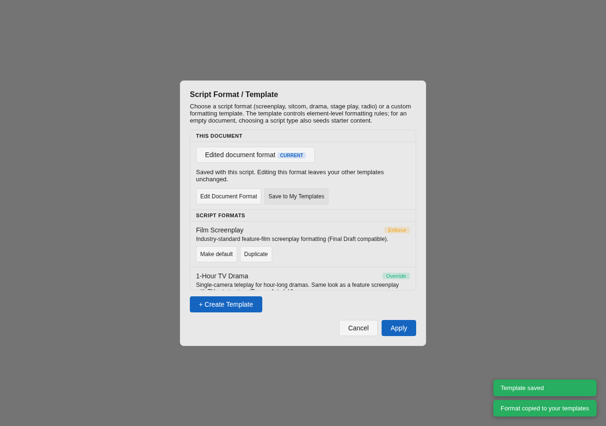
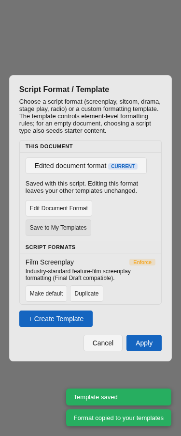

# Portable custom formats and DOCX dual dialogue

Custom formatting templates now travel with a native script, and Word export keeps both sides of a dual-dialogue exchange.

## Document formats

Saves embed `_templateSnapshot` alongside `_templateId` for custom formats. The definition includes custom elements, typography, numbering, flow and page defaults, starter content and script-type settings. Built-in formats keep their existing ID-based representation. Snapshot data is copied at save/load boundaries, so editing another document or template cannot mutate a previously saved payload.

The open document has a separate `documentTemplate` in the formatting store. A library template with the same ID remains intact. Delayed template-library loading cannot discard the document's definition. Opening an older script without a snapshot uses the existing local lookup; switching documents clears the previous document's copy. Snapshot readers check IDs and field types, accept older missing optional fields, and ignore malformed definitions. Built-in IDs always resolve to the built-in definition.

Format → Formatting Template shows **This Document**, with **Edit Document Format** and **Save to My Templates**. The latter creates a new library ID. Applying a library template is an explicit replacement of the document's current format. Changes to the active format enter the existing metadata-save path even when no text changes.

Native export, project saves, recovery and backups use the shared save payload. Background linked exports resolve numbering from that saved document's snapshot rather than the currently open script. Font files themselves are not embedded. External formats cannot carry the complete OpenDraft template definition, and older OpenDraft versions may discard snapshots on save; keep native backups.

Collaboration shares template ID, custom snapshot, current page settings and scene-heading spacing as one `documentFormat` metadata entry. Recipients use a document-scoped copy and retain their library. Format changes use the same last-writer-wins metadata semantics as other formatting choices. Legacy sessions that do not send a format packet retain their prior behavior; a joining guest does not seed its unrelated local format into those sessions. All participants need an updated client for portable formats.

## Word dual dialogue

The exporter recognizes a `dualDialogue` container and writes a borderless fixed-width table with two equal columns inside the document's content margins. Cues, parentheticals, dialogue runs, fonts, emphasis, hard breaks, element numbers and revision marks use the existing Word paragraph/run builder, with column-relative indents and tabs. A forced break before the exchange remains before the table.

Word may split the row across pages for long speeches. It controls line breaking and page counts; this change does not impose OpenDraft's PDF pagination on Word. Adjacent tables have a tiny, named layout-only separator paragraph. The importer skips that separator and builds two valid `dualDialogueColumn` nodes, so repeated round trips do not accumulate blank script paragraphs.

Only the dual-dialogue and numbered-podcast DOCX golden outputs change. Other export snapshots stay unchanged.

## Verification

Regression tests cover clean-device reopening, same-ID library collisions, detached snapshots, legacy ID-only files, delayed library loading, document-only edits, format-change notifications, background export numbering and Yjs format updates. Word tests inspect the actual archive XML and re-import it: both columns, inline formatting, margins, long speeches, forced breaks, empty columns and repeated conversions are covered.

Chromium checks use the real template-manager components with a simulated template API: edit the document copy, preserve a conflicting local template, save a reusable copy, and keep controls within desktop and 375px viewports. Actual Microsoft Word rendering still needs verification on a machine with Word installed.

